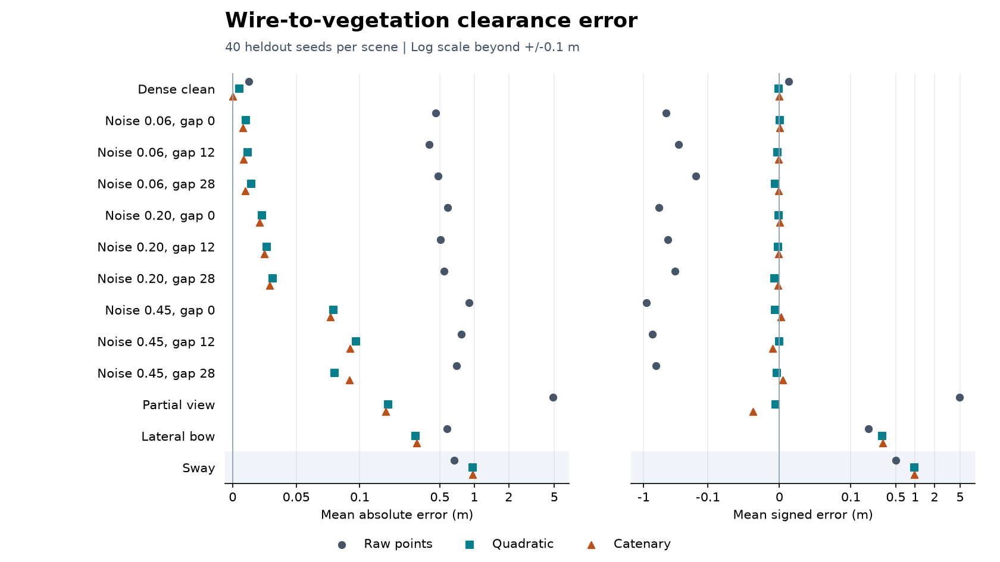

# sag-fit

When does fitting a catenary improve minimum wire-to-vegetation clearance
estimated from a sparse 3D point cloud? This Python CLI compares raw points, a
robust quadratic, and a robust catenary on the same synthetic scenes.

## Quickstart

```sh
python -m pip install -r requirements.txt
python -m unittest -v
python sag_fit.py
```

The CLI prints a table and writes `results/clearance.json` with per-seed
estimates and `results/clearance.png` with the comparison chart. Use
`--split dev --out-dir dev-results` for a quicker run.

## Experiment

- Each seed defines a 100 m wire span, a vertical catenary, and two clusters of
  vegetation points. The reconstruction proxy samples 180 wire points, adds
  anisotropic Gaussian noise and gross errors to 12% of points, then applies
  the visibility mask. The dense clean control uses 360 samples with no noise
  or outliers.
- The static sweep crosses noise scales of 0.06, 0.20, and 0.45 m with central
  gaps of 0, 12, and 28 m. Noise standard deviations along the span, across
  the span, and vertically are 0.6, 1.5, and 1.0 times the scale. The partial
  view exposes only chainage -44 to -8 m. Separate stress cases add a fixed
  1.2 m lateral bow or time-varying sway with 1.4 m peak lateral displacement
  and 0.42 m peak vertical displacement.
- Raw clearance is the minimum 3D distance between an observed wire point and
  a vegetation point. Both fits use a lateral line and fit height as either a
  quadratic or a catenary in known span coordinates. Each uses 48 four-point
  RANSAC draws with a fixed 0.85 m lateral/vertical residual threshold, then
  refines the winning inliers with SciPy soft-L1 least squares.
- Both fits are evaluated across the full known span on a 5 cm grid, including
  regions hidden from the reconstruction. Truth uses the same grid on the
  ideal wire. Sway observations combine phases as chainage advances, and the
  target is the minimum clearance across 64 phases of a cycle.
- Development seeds are 0-7. The reported run uses held-out seeds 1000-1039
  for every scene. The settings were fixed before evaluating those seeds.
  Reusing seeds across scenes pairs the underlying geometry and corruption
  draws for the noise and gap comparisons.

## Held-out results

Mean absolute error in minimum clearance, in meters (40 seeds per scene,
520 trials). Both fits returned estimates in every trial.

| Scene | Raw points | Quadratic | Catenary |
| --- | ---: | ---: | ---: |
| Dense clean | 0.013 | 0.005 | 0.000 |
| Noise 0.06 m, gap 0 m | 0.459 | 0.010 | 0.008 |
| Noise 0.06 m, gap 12 m | 0.403 | 0.012 | 0.009 |
| Noise 0.06 m, gap 28 m | 0.485 | 0.014 | 0.010 |
| Noise 0.20 m, gap 0 m | 0.583 | 0.023 | 0.021 |
| Noise 0.20 m, gap 12 m | 0.504 | 0.027 | 0.025 |
| Noise 0.20 m, gap 28 m | 0.544 | 0.032 | 0.029 |
| Noise 0.45 m, gap 0 m | 0.899 | 0.079 | 0.077 |
| Noise 0.45 m, gap 12 m | 0.767 | 0.097 | 0.092 |
| Noise 0.45 m, gap 28 m | 0.702 | 0.080 | 0.092 |
| Partial view | 4.873 | 0.178 | 0.168 |
| Lateral bow | 0.579 | 0.307 | 0.315 |
| Sway | 0.666 | 0.970 | 0.968 |

- Across the nine static noise-and-gap settings, pooled MAE was 0.594 m for
  raw points, 0.042 m for the quadratic, and 0.040 m for the catenary.
  The quadratic had lower MAE at the highest noise with the widest gap
  (0.080 vs. 0.092 m) and with lateral bow (0.307 vs. 0.315 m).
- Under sway, the raw points had the lowest MAE. The quadratic and catenary
  overestimated worst-phase clearance in all 40 trials, by an average of
  0.970 and 0.968 m, respectively. Raw points overestimated in 29 of 40 trials.

The [held-out JSON](benchmark/clearance.json) includes signed bias, 90th
percentile absolute error, overestimate counts, and individual trials.
The run used Python 3.13.1, NumPy 2.5.5, SciPy 1.18.1, and Matplotlib 3.11.2.



## Limitations

Simulation only. All points are synthetic, and the project uses no Kanopy
code or data. The experiment assumes known metric scale, gravity, span axis
and bounds, conductor association, and exact vegetation samples. It
approximates reconstruction artifacts directly in 3D and omits camera pose,
triangulation, and vegetation reconstruction. The ideal distances are to
sampled branch tips, and sway truth is sampled in space and phase. A single
static curve cannot recover the minimum over a motion cycle from this model
of mixed-phase observations.
